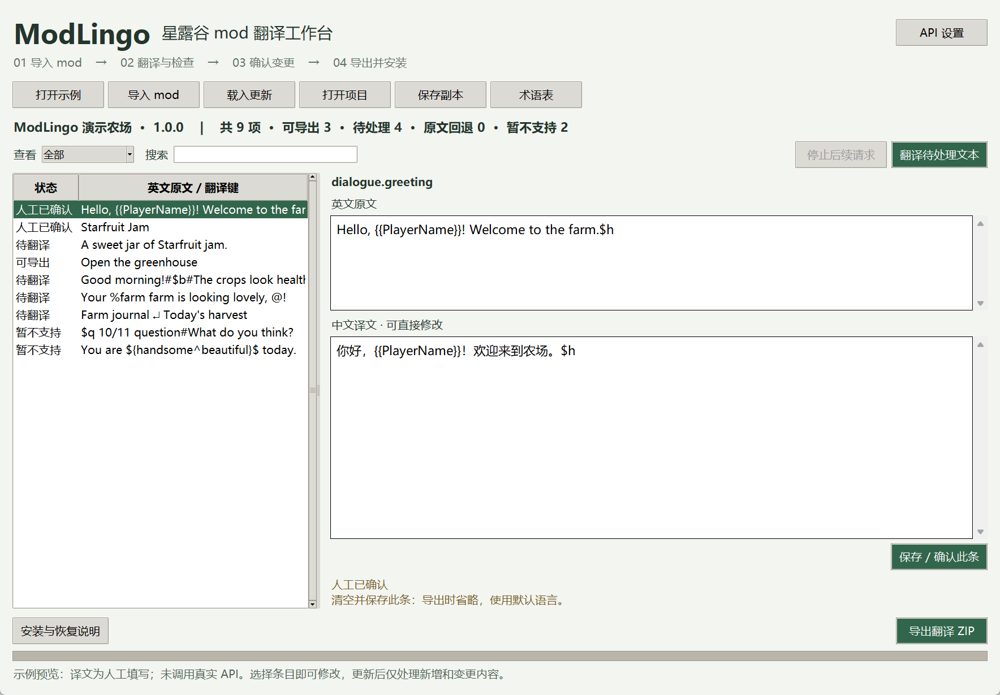

# 历史更新记录

## 0.6.16 · 公开Beta用量控制与开发入口

- 整轮请求/token预算覆盖并发、HTTP重试及格式修复；用量未知保留预留，人民币按用户填写单价估算。
- 限额暂停保留已完成译文，提供不含路径、原文、密钥的反馈摘要。
- 源码启动、构建和Bridge目录可自动发现或显式覆盖，去除通用入口固定盘符要求。
- 发布前增加六组Windows/Linux回归门槛，修复Windows短计时器触发测试截止后仍可能重试的边界。
- 第二台电脑和完整游戏人工显示验收继续保留待办，不宣称95%覆盖。

以下归档公开Beta整理前的README，保留历史版本的原始说明。历史支持范围、统计和限制只适用于当时版本；当前内容以README及本版发行说明为准。

# ModLingo · 星露谷 mod 批量汉化

**项目状态：新一轮更新中（2026-11-21）。** 当前工作在 `codex/api-compatibility` 开发分支，重点为名称依赖回填、Python/Bridge 共用资源规则与 Anaconda 环境迁移。0.6.15 已完成本地验证，当前更新不作为新的正式发行版；详见 [当前状态](docs/CURRENT_STATE.md)。

Windows 中文桌面工具：打开后自动识别游戏与 Mods 目录，配置自己的模型 API，默认全选 mod，批量翻译并直接安装中文，最后查看成功、失败和部分完成名单。

**当前源码/本地交付版本：0.6.15，配套 Bridge 0.5.9。** 本版新增翻译任务依赖与同轮回填，并让 Python 和 Bridge 共享一份资源提取规则。保留配置实际值、自定义名称、已有译文和缓存；不宣称全库或游戏显示覆盖率已达到95%。参见 [依赖回填与共享规则说明](docs/0.6.15依赖回填与共享提取规则.md)、[矿车资源适配说明](docs/0.6.14矿车资源适配.md) 与 [当前状态](docs/CURRENT_STATE.md)。

[0.5.3 配置界面兼容说明](docs/0.5.3配置界面兼容.md) · [0.5.2 提速与使用说明](docs/0.5.2提速说明.md) · [0.5.1 修复说明](docs/0.5.1修复说明.md) · [0.5.0 基础测试指南](docs/0.5.0测试指南.md) · [性能与验证记录](docs/验证记录.md) · [伴随插件说明](bridge/README.md) · [GitHub 已发布旧版](https://github.com/LILILI2007/transformer/releases/tag/v0.4.0)



## 0.6.9 世界地图文字

[0.6.9 地图文字说明](docs/0.6.9世界地图文字.md)。桌面及Bridge0.5.4支持Data/WorldMap中区域滚动文字和悬停提示，按唯一字面Id定位；同词不同ID不串译，坐标、条件、纹理和邻接ID不改写。固定快照3个mod新增39记录/31片段，包括SVE、Remapping和Nora。263项测试中262通过、1跳过；隔离真实资源探针通过，地图UI排版及玩家mod逐项生效仍待验收。退出游戏后在新包点击“安装采集插件”更新Bridge，再重新扫描翻译。本轮无收费调用。

## 0.6.8 混合引用的待采集清单

[0.6.8 待采集说明](docs/0.6.8混合引用采集提示.md)。混合i18n与硬编码文字不再静默省略覆盖缺口；报告列出资源、字段位置和采集步骤，区分已观察位置与未观察位置，不把一份条件版本当作全部完成。固定快照13个mod共326字段纳入待采集清单，静态提取量和总分类数量未变。252项测试中251通过、1跳过，真实隔离采集状态探针通过；本轮无付费API。

## 0.6.7 剧情结束后的对白

[0.6.7 结束对白说明](docs/0.6.7结束对白兼容.md)。补充明确格式的 end dialogue 与 end dialogueWarpOut 文字，角色ID、结束方式和脚本结构不变；只补遗漏英文，保留玩家已有对白。新增独立缓存上下文，其他文字的历史上下文不因新增片段移位。244项测试中243通过、1跳过；游戏资源加载、原生参数解析及混合i18n解析后采集探针通过。静态覆盖数量未变，真实事件结束执行仍待验收。本轮无付费API，Bridge仍0.5.3。

## 0.6.6 剧情头部识别

[0.6.6 剧情头部说明](docs/0.6.6剧情头部识别.md)。完整字面音乐/视口/演员头部不再误报未知命令，所有原参数保持不变。122项固定原文审计识别63条头部，减少128条误报，47字段清除未覆盖提示；不增加或跳过任何文本片段。235项测试中234通过、1跳过；真实隔离资源加载探针通过，实际开演仍待验收。本轮无付费API。

## 0.6.5 排除确定的外语专用补丁

[0.6.5 语言范围说明](docs/0.6.5语言范围优化.md)。中文目标下仅排除明确指定其他已知语言的 CP 补丁；英语、中文、动态或不确定条件继续保留。122项原文快照减少104个片段、5163字符，约0.11%片段，不据此承诺全库提速。真实隔离 CP 探针验证外语补丁不生效、英语原文可提取及作者中文不被覆盖。228项测试中227通过、1跳过；本轮无付费API，Bridge仍0.5.3。

## 0.6.4 NPC 头顶气泡文字

[0.6.4 气泡文字说明](docs/0.6.4气泡文字兼容.md)。新增已确认格式的 textAboveHead 文本解析，角色ID、命令与参数保持原文。隔离真实标题探针验证中文事件资源，并执行游戏原生命令确认临时NPC收到中文气泡文字；没有加载存档或进入游戏世界。新增气泡片段使用独立缓存上下文，旧对白缓存与玩家译文仍可复用。217项测试中216通过、1跳过，本轮无付费API。

## 0.6.3 合并字段失败恢复

[0.6.3 实测与修复说明](docs/0.6.3字段恢复实测.md)。合并字段的标记或格式校验失败后，在原始8请求预算内递归拆分，严格校验并即时保存成功片段。真实复杂字段实测15/16通过后，只复验失败字段；再次拒绝多余标记并拆成两组，剩余5片段通过。5轮实测已结束，累计217请求、按用量估算约0.73元；本次专用凭据已清除。该结果不代表全库十分钟或全部游戏界面验收。

## 0.6.2 快速问答分支兼容

[0.6.2 修复说明](docs/0.6.2快速问答修复.md)。按游戏自带 XML 定义拆分 quickQuestion 问题、选项及分支对话，保留分隔符、命令、参数和顺序。修复部分旧译文遗漏英文问题/选项却被当成完成的情况；保留玩家已译分支，仅补缺。197项回归中196通过、1跳过。真实资源加载探针通过，实际剧情选择分支仍待验收；本轮无付费调用。

## 0.6.1 嵌套资源路径修复

[0.6.1 兼容修复说明](docs/0.6.1嵌套路径修复.md)。修复 CP `TargetField` 的静态嵌套路径丢失：提取记录与 Bridge 采集索引都保留前缀。真实隔离探针验证名称、说明替换，以及内部 ID/价格不变。动态路径和无效路径保留待处理；不宣称全部资源已适配。本轮无付费 API。

## 0.6.0 限额实测与 GMCM 修复

[0.6.0 实测说明](docs/0.6.0限额测试.md)。Bridge 0.5.2 修复随机字段 ID、数字格式显示和早期注册采集，附常用 mod 中文显示别名。DeepSeek 缩短保护标记，在保留严格校验的同时降低请求开销。并发上限提高至 32，限流时自动降低。

186 项离线测试中 185 通过、1 项环境相关跳过。真实同组 512 条样本：4 路 29.75 秒，32 路 6.234 秒；短标记方案 32 路 5.203 秒。它们是样本结果，不能证明全部 mod 十分钟翻译完成。全量冷缓存预检费用约为保守21.29元，超过本次单轮3元预算，未执行全量收费验收；动态界面仍需访问采集。

## 0.5.3 配置界面兼容

Bridge 0.5.1 新增 GMCM mod 显示名称和下拉选项显示文字采集/替换。只改变界面显示，不修改 manifest、UniqueID 或配置实际值。DLL 的声明名称可以先静态提取，其他已注册名称在访问配置列表时采集；标签、说明和选项仍需打开相关页面及下拉框采集，然后退出游戏、重新扫描和翻译。

安装插件译文时自动补齐缺失或旧版伴随程序，保留已有译文和采集记录。i18n 文件异常会明确报告，并允许独立插件采集继续工作，不自动改写损坏 JSON。增加 `$query` 条件分支、`$action` 动作参数和带尾部空格的数字物品列表保护。详情见配置界面兼容说明；完整玩家 UI 布局仍待验收。

## 0.5.2 翻译提速与必要性核对

先后台扫描和复用缓存，再显示实际待译字段、唯一待译片段及初始 HTTP 请求估算，确认后才发送翻译请求。片段数与请求数分别显示。普通文本优先整字段翻译，保留语境，减少人工片段分隔符；事件和邮件附件仍通过结构适配器保护。

批次按 mod 和文本长度分别调整，连续成功三次后逐步回升到最多 20 条；轮流派发不同 mod，缩批不会永久锁死为每批一条。相同完整长文本在同 mod、同用途范围内合并，并持久保存完整译文；短标签、不同角色、已有部分缓存及冲突的玩家修改不强行合并。已有有效中文和手动回退优先保留。

DeepSeek 新预设默认关闭思考；可以在配置中调整。已完成片段立即入 SQLite，失败片段单独补试，仍遵守每原始批次 8 次 HTTP 上限。断网、鉴权错误及失败熔断规则保留。插件版本仍为 0.5.0；没有扩大游戏内覆盖承诺。详情和离线测试数据见提速说明。

## 0.5.1 失败与时间估算修复

修复内部片段分隔符被误判为非法标记的问题；保留原有参数、数量与顺序校验。批次计入分隔符和输出开销，截断后缩小后续批次，高失败率暂停；拒绝/工具调用不再反复按格式错误重试。显示失败片段，“本轮剩余”扣除已失败工作并排除扫描迁移耗时。

真实准备数据 116 个 mod、51,189 条记录、85,075 个片段的离线结构回归通过。使用模拟输出，未使用真实密钥、不代表游戏内效果或译文质量。新增逐请求诊断，不记录密钥或文本正文。当前 142 项测试，141 通过、1 项权限跳过。旧成功候选和备份保留；插件仍为 0.5.0。详情见修复说明。

## 0.5.0 翻译与恢复

默认 4 路异步 HTTP 连接池，用户可选 1–6、8、16、32 路。不同 mod 轮流分配批次，默认每批最多 20 个请求条目、6000 原文字符，并根据输出上限收缩；同字段的文字片段以保护标记合并。截断或格式失败拆分，只重试缺失部分，每个原始批次共用最多 8 次 HTTP 请求预算。鉴权、模型、地址错误暂停；限流退避并降低并发。

界面每秒显示完成片段、缓存命中、处理中请求、重试等待、阶段、最后响应和预计时间。扫描/解析/旧缓存迁移由子进程处理；单 mod 编辑器每页 200 行。停止取消本地等待，保存已返回结果；已发送请求仍可能计费。SQLite 增量保存，避免每批重写大型项目 JSON。

支持平铺和分文件 i18n、CP Include/JSON Load、明确的对话/邮件/事件/任务/物品文字字段。结构解析保留命令、ID、条件和附件；未知片段列明原因并保留原文。CP、DLL、XNB 原文件不修改，资源/界面译文通过离线伴随插件应用。

DLL/XNB 操作：安装采集插件 → 用 SMAPI 进入相关界面 → 退出 → 重新扫描并翻译 → 再进游戏验证。插件不存密钥、不调用 API。DLL 只覆盖可归属文字；动态拼接、未访问界面和未知来源不保证覆盖。

固定延迟模拟中 4 路吞吐达到串行 3.15 倍，万条测试和缓存零请求复跑通过。二十分钟是优化目标，不能用模拟耗时推算真实付费 API。122 个 mod 的静态表与游戏内验收分开，未宣称全库 90% 已汉化。

## API 验证后才能翻译（0.4.1）

翻译按钮默认禁用。配置后点击“保存并测试”或主界面的“验证 API”，确认可能计费后，程序检查接口、模型、译文 JSON、占位符、换行及中文输出。成功会弹窗并显示“API 验证成功”，随后解锁翻译。失败显示原因并保持禁用。仅保存设置不算验证成功；重新保存配置或重启程序后需要重新验证。验证仅对本次运行中的当前配置有效，不能保证后续额度、网络或全部译文质量。

## API 支持名单（0.4.0）

**重点支持：DeepSeek、千问/百炼、Kimi、OpenAI、Claude。** 扩展支持 Gemini 兼容接口、硅基流动、OpenRouter、Ollama、LM Studio。提供北京/新加坡千问预设、OpenAI Responses/Chat 两种预设、Claude 原生 Messages，以及自定义三协议入口。

这里的支持表示官方文档核对、适配实现和本地 HTTP 协议测试通过。**本次没有真实 API 凭据，尚未完成各厂商真实鉴权和模型质量验收，不保证所有模型兼容。** 只支持非流式文本接口。

点“配置 API”先选厂商，再填模型 ID 与密钥。DeepSeek 和千问预设默认关闭思考；Claude 支持工作区 ID；输出上限和超时可调整。切换厂商会清空密钥。模型返回截断、拒绝、工具调用或仅思考内容时不会写入译文。

**[完整 API 支持名单、配置地址、限制与官方文档](docs/API支持名单.md)** · [验证记录](docs/验证记录.md)

## 农场风格界面

蓝天、像素山丘、农舍、小鸡和幼苗组成原创景观横幅，搭配木框、暖色纸张及绿色主按钮。批量工作台、API 配置与单 mod 编辑器使用统一主题，无新增运行依赖。

统计区显示发现、勾选、成功和需要关注的数量；可按名称、UniqueID、目录或原因搜索，并筛选已勾选、成功或需要关注的 mod。筛选只影响显示，不改变勾选；全选/全不选作用于整个清单。选中一行可阅读完整原因。

小窗口缩短横幅并折叠统计区，为清单和操作按钮保留空间。状态同时使用中文与颜色区分。美术参考来源与原创绘制说明见 [界面设计](docs/界面设计.md)。

## 玩家使用：五步完成

1. 解压下载包，运行 `ModLingo/ModLingo.exe`。完整保留同目录文件，无需安装 Python。
2. 应用自动检查 Steam 库、Windows 注册表及常见 Steam/GOG/Xbox 安装位置，定位游戏下的 Mods。多份游戏需选择一份；找不到时点“手动选择”。会记住选择，下次启动重新扫描。
3. 点“配置 API”，先选厂商预设，再填写模型 ID、密钥和需要调整的地址。测试连接可能计费。密钥只在本次运行内存中。
4. mod 默认全选，可点击选择列或按空格取消。退出游戏和 SMAPI，点击“开始翻译并安装”，确认费用与写入范围后开始。
5. 查看成功、部分完成、失败和不支持名单；中文直接写入 `i18n/zh.json` 或分文件布局的 `i18n/zh/ModLingo.generated.json`。进入游戏后选择中文，并通过 SMAPI 启动。

工具不改游戏语言设置、不安装 SMAPI。只有 mod 自身使用支持的 i18n 入口时，中文文件才会生效。结构检查无法保证剧情语义准确；先查看名单，再进游戏检查。

## 名单、重试与恢复

- **成功**：此 mod 所有源文条目已有可用中文，文件已安装或已是相同内容。
- **部分完成**：可用译文已安装，但存在复杂语法、超长文本或主动回退条目。归入失败或部分完成名单，列出数量及原因，不算全部成功。
- **失败**：没有可安装译文、重复 UniqueID、文件损坏、API 错误、目录变化、权限问题或用户停止。该 mod 未完成安装，原中文保留。
- **不支持**：没有标准语言入口；可能是贴图/功能组件无需汉化，也可能将文本写在 content.json、DLL 或 XNB 中。不将它们描述为 API 翻译失败。
- 一个 mod 失败继续处理其他 mod；400/401/403/404/429 服务错误停止剩余付费请求并逐个记入名单。
- 每个成功批次保存翻译进度。修复问题、重新扫描并重试，未变译文和已成功批次会复用。
- 每次改写前备份已有中文；原来没有中文文件，也记录这一事实。点击“从结果记录恢复中文备份”选择对应结果 JSON，可恢复原文件或移除本次新增文件。后续被玩家修改的文件不会强行覆盖。

本机目录为 `%LOCALAPPDATA%/ModLingo/`：`reports/` 保存 JSON 与文本名单，`backups/` 保存原中文和恢复凭据，`batch-projects/` 保存批量进度。备份和记录包含本机路径及 mod 文本，不要直接公开上传。没有 API 密钥。

## 当前兼容范围

| 输入 | 处理 |
|---|---|
| 单 mod 的 manifest.json 与 i18n/default.json，可选 zh.json | 支持，英语→简中 |
| Content Patcher 通过标准 i18n 引用的文本 | 在上述布局中支持 |
| 分文件 i18n/default/*.json | 合并读取并查重；补充写入 zh/ModLingo.generated.json，原中文分文件保留 |
| 硬编码 content.json、DLL、XNB | 不提取，不修改 |
| 复杂事件/分支对话、未知控制语法 | 跳过并报告；保留已有对应中文，否则回退默认语言 |
| 链接或目录联接、重复 UniqueID | 不自动写入，名单说明原因 |
| 自定义 SMAPI --mods-path 或 mod 管理器隔离目录 | 不自动推断；目前需使用所选游戏下实际 Mods |

支持部分 `{{…}}`、`@`、`%name`、`#$b#` / `#$e#`、简单表情标记，保守要求内容、数量、顺序及换行数量一致。不是完整游戏脚本解析器。已有中文中的额外键和复杂项在批量安装时保留，default.json 和 manifest.json 不修改。

## 单 mod 编辑与源码运行

本机项目环境已迁移到 Anaconda 的 `modlingo`（Python 3.9）。双击 `Start.cmd`，或激活 `modlingo` 后运行源码；测试和构建脚本自动选择新环境。重建文件为 `environment.yml` 与 `requirements-environment.lock.txt`，详见 [Anaconda 环境说明](docs/Anaconda环境迁移.md)。

主界面的“单 mod 编辑”保留上一版的逐条编辑、术语表、项目副本及 ZIP 导出。批量项目与单 mod 项目目前独立；批量操作以实际 mod 中文文件为输入。

```powershell
python -m modlingo
python -m modlingo --editor
python -m unittest discover -s tests -v
python -m modlingo --smoke
powershell -ExecutionPolicy Bypass -File scripts/build_windows.ps1
```

源码运行需要 Python 3.9+、Tkinter 和 HTTPX 0.28.1（执行 `pip install -e .` 安装依赖）；Windows 便携包自带运行库。构建使用固定版本 PyInstaller，便携包未签名。开发者提交消息含 `[release]` 或推送 v 开头标签时，云端验证后发布预览版。

[使用指南](docs/使用指南.md) · [验证记录](docs/验证记录.md) · [技术设计](docs/技术设计.md) · [开发路线](docs/开发路线.md)

源码使用 MIT。游戏、mod 和文本版权仍归各自权利人；发布译文需核对作者许可。后续方向包括玩家指定翻译语言、多文件 i18n 与更多语法。
