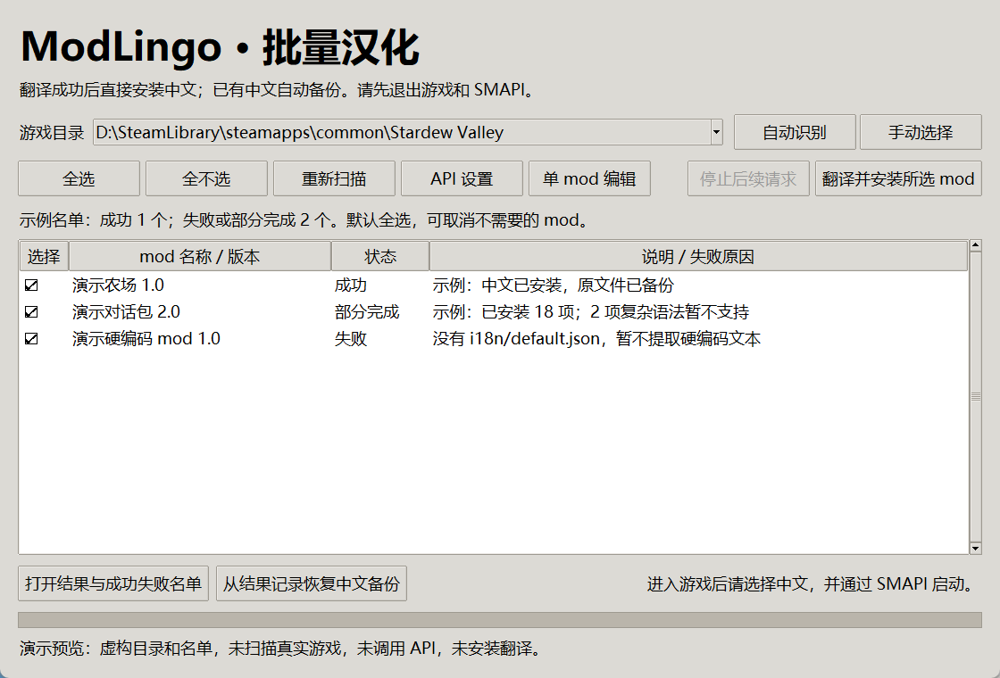

# ModLingo · 星露谷 mod 批量汉化

Windows 中文桌面工具：打开后自动识别游戏与 Mods 目录，配置自己的模型 API，默认全选 mod，批量翻译并直接安装中文，最后查看成功、失败和部分完成名单。

**当前版本：0.2.0 预览版。** 支持标准平铺 i18n 文件，暂不支持任意 mod 全量汉化。自动目录识别和安装机制已用测试目录验证，尚未完成真实玩家游戏环境验收。

[下载 Windows 便携版](https://github.com/LILILI2007/transformer/releases/download/v0.2.0/ModLingo-Windows-x64.zip) · [发行说明与源码](https://github.com/LILILI2007/transformer/releases/tag/v0.2.0)



## 玩家使用：五步完成

1. 解压下载包，运行 `ModLingo/ModLingo.exe`。完整保留同目录文件，无需安装 Python。
2. 应用自动检查 Steam 库、Windows 注册表及常见 Steam/GOG/Xbox 安装位置，定位游戏下的 Mods。多份游戏需选择一份；找不到时点“手动选择”。会记住选择，下次启动重新扫描。
3. 点“API 设置”，填写服务地址、模型名、密钥。测试连接可能计费。密钥只在本次运行内存中。
4. mod 默认全选，可点击选择列或按空格取消。退出游戏和 SMAPI，点击“翻译并安装所选 mod”，确认费用与写入范围后开始。
5. 查看成功、失败或部分完成名单；中文已直接写入各 mod 的 `i18n/zh.json`，无需复制 ZIP。进入游戏后选择中文，并通过 SMAPI 启动。

工具不改游戏语言设置、不安装 SMAPI。只有 mod 自身使用支持的 i18n 入口时，中文文件才会生效。结构检查无法保证剧情语义准确；先查看名单，再进游戏检查。

## 名单、重试与恢复

- **成功**：此 mod 所有源文条目已有可用中文，文件已安装或已是相同内容。
- **部分完成**：可用译文已安装，但存在复杂语法、超长文本或主动回退条目。归入失败或部分完成名单，列出数量及原因，不算全部成功。
- **失败**：没有支持入口、重复 UniqueID、文件损坏、API 错误、待复核译文、目录变化、权限问题或用户停止。该 mod 未完成安装，原中文保留。
- 一个 mod 失败继续处理其他 mod；401/403/404/429 服务错误停止剩余付费请求并逐个记入名单。
- 每个成功批次保存翻译进度。修复问题、重新扫描并重试，未变译文和已成功批次会复用。
- 每次改写前备份已有中文；原来没有中文文件，也记录这一事实。点击“从结果记录恢复中文备份”选择对应结果 JSON，可恢复原文件或移除本次新增文件。后续被玩家修改的文件不会强行覆盖。

本机目录为 `%LOCALAPPDATA%/ModLingo/`：`reports/` 保存 JSON 与文本名单，`backups/` 保存原中文和恢复凭据，`batch-projects/` 保存批量进度。备份和记录包含本机路径及 mod 文本，不要直接公开上传。没有 API 密钥。

## 当前兼容范围

| 输入 | 处理 |
|---|---|
| 单 mod 的 manifest.json 与 i18n/default.json，可选 zh.json | 支持，英语→简中 |
| Content Patcher 通过标准 i18n 引用的文本 | 在上述布局中支持 |
| 分文件 i18n/default/*.json | 当前明确报告不支持 |
| 硬编码 content.json、DLL、XNB | 不提取，不修改 |
| 复杂事件/分支对话、未知控制语法 | 跳过并报告；保留已有对应中文，否则回退默认语言 |
| 链接或目录联接、重复 UniqueID | 不自动写入，名单说明原因 |
| 自定义 SMAPI --mods-path 或 mod 管理器隔离目录 | 不自动推断；目前需使用所选游戏下实际 Mods |

支持部分 `{{…}}`、`@`、`%name`、`#$b#` / `#$e#`、简单表情标记，保守要求内容、数量、顺序及换行数量一致。不是完整游戏脚本解析器。已有中文中的额外键和复杂项在批量安装时保留，default.json 和 manifest.json 不修改。

## 单 mod 编辑与源码运行

主界面的“单 mod 编辑”保留上一版的逐条编辑、术语表、项目副本及 ZIP 导出。批量项目与单 mod 项目目前独立；批量操作以实际 mod 中文文件为输入。

```powershell
python -m modlingo
python -m modlingo --editor
python -m unittest discover -s tests -v
python -m modlingo --smoke
powershell -ExecutionPolicy Bypass -File scripts/build_windows.ps1
```

运行仅需 Python 3.9+ 和 Tkinter，不需要第三方运行库。构建使用固定版本 PyInstaller，便携包未签名。开发者提交消息含 `[release]` 或推送 v 开头标签时，云端验证后发布预览版。

[使用指南](docs/使用指南.md) · [验证记录](docs/验证记录.md) · [技术设计](docs/技术设计.md) · [开发路线](docs/开发路线.md)

源码使用 MIT。游戏、mod 和文本版权仍归各自权利人；发布译文需核对作者许可。后续方向包括玩家指定翻译语言、多文件 i18n 与更多语法。
