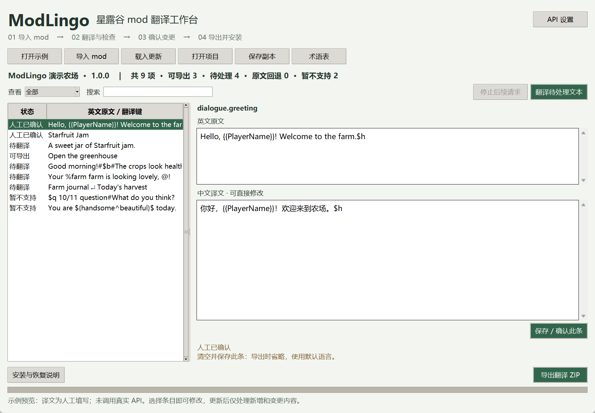

# ModLingo · 星露谷 mod 中文翻译工作台

为 Windows 玩家的星露谷 mod 翻译英语文字，安装可用中文，并保留备份以便恢复。支持标准 i18n、部分 Content Patcher 资源及配套 Bridge 可识别的界面文字。

**Beta：0.6.16 / Bridge0.5.9。** 提供整轮用量限制、隔离配置自动化验收和玩家指南。第二台电脑和完整存档剧情的人工验证仍待完成，不承诺任意 mod 全量汉化或95%游戏内覆盖率。

**[下载 Windows x64 测试版](https://github.com/LILILI2007/transformer/releases/tag/v0.6.16)** · [玩家指南](docs/玩家指南.md) · [常见问题](docs/常见问题.md) · [兼容性](docs/兼容性清单.md) · [反馈问题](https://github.com/LILILI2007/transformer/issues/new?template=bug.yml)

选择 `ModLingo-Windows-x64.zip`，完整解压后运行 `ModLingo/ModLingo.exe`，保留配套文件。**玩家无需安装 Python 或 Anaconda。** `ModLingo-source.zip` 是开发者源码包。

## 三步开始

1. 退出游戏与 SMAPI，启动程序，确认游戏和实际 Mods 目录。
2. 配置自己的 API 地址、模型和密钥，点击“验证 API”；验证和后续翻译可能计费。
3. 首次先选1—2个 mod，确认请求计划后翻译；查看结果，再通过 SMAPI 以中文进入对应场景验收。

需要运行时文字时，先安装采集插件，进入相关菜单或地图，再退出游戏、重新扫描并补译。一次采集不代表全部条件版本均已覆盖。

## 适用范围

发布目标为 Windows10/11 x64。参考组合为星露谷1.6.15、SMAPI4.5.2、CP2.9.1、GMCM1.16.0；其他组合不视为全部验收通过。翻译方向为英语→简中，需自备可用模型服务。

| 来源 | 当前行为 |
|---|---|
| 平铺、分文件 i18n | 提取、翻译和合并安装，保留已有中文及额外键 |
| CP静态 Include、JSON Load、已支持字段 | 按白名单和稳定路径提取，通过Bridge应用资源译文 |
| 世界地图、矿车等适配资源 | 只改识别出的显示文字，保留ID、坐标、价格和配置实际值 |
| DLL/运行时界面 | 仅采集可确定来源的受支持文字，部分需实际访问 |
| XNB/动态资源 | 经游戏加载后的受支持资源采集，不通用反编译XNB |
| 图片文字、任意DLL字符串、未知脚本 | 不保证支持，保留原文并报告待处理原因 |

CP、DLL、XNB原文件不改写。输出可能写入i18n或Bridge字典。自定义 `--mods-path` 与管理器隔离目录暂不自动推断；当前处理选定游戏下实际Mods。[详细边界](docs/兼容性清单.md)

## 费用、数据与恢复

- 云端翻译会把待译文本和必要上下文发送给配置的服务商，费用由对应账号承担。
- 默认整轮最多500次请求、200万token预算，含并发及重试；可在API设置调整。输入按保守预留估算，金额按填写单价估算，不是服务商账单硬限额。[费用规则](docs/API支持名单.md)
- 密钥不写入公开项目和翻译包；反馈可用“导出脱敏摘要”。本机原始报告及备份可能含路径与mod文本，不要直接公开上传。
- 安装前自动备份已有中文；使用“从结果记录恢复中文备份”。玩家后续修改会拒绝覆盖。
- 默认数据在 `%LOCALAPPDATA%/ModLingo/`；升级保留该目录、更新Bridge并重新扫描，以复用合格缓存。

## 验证与反馈

已有源码回归、跨语言规则对照、隔离游戏标题探针及云端构建记录。自动化首次使用验收覆盖空缓存、复跑、原文更新和恢复。

模拟响应不代表真实模型质量，标题探针不等于全部游戏显示验收。第二台电脑、真实付费调用和完整存档剧情仍保留人工待办。[Beta验收范围](docs/Beta验收.md)

反馈请附工具、Windows、游戏、SMAPI及mod版本和最小复现步骤；不要附密钥、完整mod或存档。程序未签名，来源提示及常见问题见玩家指南。

[发行说明](docs/release-notes.md) · [当前状态](docs/CURRENT_STATE.md) · [历史更新](CHANGELOG.md) · [安全与隐私](SECURITY.md)

## 源码开发

源码采用MIT。开发者从[开发指南](docs/开发指南.md)开始；普通玩家运行下载的EXE即可。游戏、第三方mod和模型服务各有自己的使用条件。

[贡献指南](CONTRIBUTING.md) · [Bridge源码与构建](bridge/README.md)
