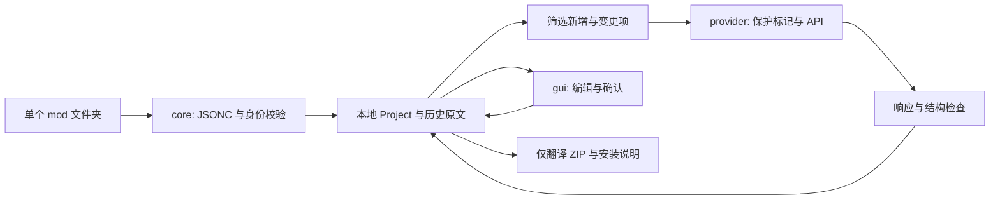

# 技术设计与实现约束

## 模块边界

运行只依赖 Python 标准库；GUI 需要 Tkinter。核心和 provider 均可无界面测试。原 mod 是只读输入；写入目标只有本地项目和用户指定的导出文件。

## 项目 schema 1

顶层为 `schema_version: 1` 和 `project`。项目字段：

| 字段 | 含义 |
|---|---|
| mod_id | manifest UniqueID，身份匹配忽略大小写 |
| name / version / folder | 展示信息与安全的 ZIP 默认文件夹名 |
| entries | 以翻译键组织的活跃条目 |
| retired | 删除键或首次导入多余中文键的归档 |
| glossary | 项目内英文→中文术语映射 |
| notices | 输入边界和本次更新提示 |

每个条目保存 `source`、`target`、`origin`、`translated_source`、`previous_source`、`previous_target`、`needs_review`、`error`。`origin` 通常为 imported、ai、manual；人工保存的空值也允许，用于主动选择回退。

状态由数据计算，不单独持久化。优先级为：不支持→错误→待确认→缺译→可导出。尚未确认的变更候选不能导出。人工主动清空的条目显示为“原文回退”，不计入待处理，也不进入翻译队列；源文变化后重新复核。

`translated_source` 是避免重复调用的关键：新候选已经对应当前原文时，即便尚待人工确认，也不会重复请求同一句。再次修改源文后，该字段落后于新源文，才重新进入变更翻译队列。

## 更新算法

1. 校验新旧 UniqueID 相同。
2. 按忽略大小写的翻译键关联；重命名键视为删除加新增。
3. 源文相同：保留所有工作数据，不以新版附带中文替换维护中的译文。
4. 源文变化：保存上一版原文和当前译文，设置 needs_review，保留旧译文供比较。
5. 新增键：创建待译条目。首版不自动采纳更新包附带的新中文，避免引入无法追溯候选。
6. 删除键：移入 retired，不再导出；重新出现的键作为新增处理，不自动复活旧译文。

仅保留每个活跃键最近一次变更对照，不是无限版本历史。归档在项目中保留，但当前 GUI 没有归档浏览器。版本号不参与大小判断。

## JSONC 解析

采用两遍词法扫描：字符串外的行注释和块注释替换为空格；随后仅在字符串外删除闭合对象/数组前的尾逗号；最后交给 JSON 解码器。保留转义引号、反斜线、字符串里的 URL 和注释样式文本。

每层对象都拒绝重复键与仅大小写不同的键。语言文件根必须是平铺对象，值必须是字符串；`$schema` 不作为译文处理。读取限制为单文件 20 MB。当前不修改原文件布局和注释，输出为规范 UTF-8 JSON。

## API 协议与安全边界

请求使用非流式 `model/messages/stream:false`。传输为标准库 urllib，不依赖服务商 SDK。基础地址追加 `/chat/completions`，已是完整地址则直接使用。远程要求 HTTPS；HTTP 仅接受 localhost、127.0.0.1、::1。

不接受地址中的用户名密码、query 和 fragment。重定向拒绝，以免 Authorization 跟随到其他主机。服务端错误体不输出；状态码映射为中文提示，避免错误回显泄漏密钥。

每批最多 8 项与约 18000 原文字符，单条超过 16000 时不进入队列。相关术语会扩大实际请求体，因此字符上限不是绝对 HTTP 字节限额或模型 token 上限。输入总长度或模型上下文限制若仍超出，应改小批次或使用合适模型。

标记替换为每请求随机前缀的 `__ML_…__` 哨兵。模型只返回数字 ID→字符串对象。程序拒绝重复 ID、缺失/多余 ID、非字符串、损坏/增添/改序保护标记及结构不一致，整批不写入；修正后重试。

结构检查是保守子集，不包含完整脚本 AST；源文复杂项提前跳过。模型提示要求忽略源文指令，但真正可验证的约束来自响应 schema 和结构检查。不能保证模型理解剧情或不发生语义偏差。

每次超时 60 秒；429/500/502/503/504 和网络错误最多三次尝试，短暂指数退避；401、403、404 不自动重试。没有读取 Retry-After、服务商 usage 或严格预算控制。批次失败后停止后续批次，避免配置错误持续消费。停止按钮不撤销在途请求。

## 线程与持久化

GUI 线程读取配置并复制任务与术语快照。后台线程仅做网络、响应解析和队列消息，不调用 Tk；GUI 定时取消息、写回当前项目并保存。运行期间不允许导入、更新、编辑和改变配置，避免响应覆盖新编辑。

项目通过同目录临时文件、flush/fsync 和 os.replace 原子替换；ZIP 也先完整写临时文件再替换。不维护滚动备份，尚无多进程锁；**不要同时打开两个实例编辑同一 mod**。本机数据目录按 UniqueID 哈希分隔，但不能替代并发控制。

关闭程序可保留已完成批次，尚在途响应可能无法保存。API 密钥从不进入 Project；环境变量是用户选择的凭据来源，本工具不负责系统环境变量的存储生命周期。

## 导出

只写安全文件夹名下的 `i18n/zh.json`、安装说明和报告。文件夹名过滤路径分隔符、Windows 非法字符和设备名；不使用 mod 提供的路径进行解压或文件写入。

支持项只要存在未处理错误、结构失败或待确认状态，整个导出被拒绝。未译/空白项省略以触发 default 回退；复杂语法项省略并报告。没有可导出译文时拒绝生成空包。失败不会替换已有 ZIP。

报告包含 mod_id、mod_version、language、exported、skipped、retired_count、verified_in_game=false，不包含 API 配置或密钥。未来只有实际实机验证记录可支持改变验证声明。

## 扩展顺序

先补多文件映射、真实 API 契约测试、语法解析器和项目迁移，再抽象游戏适配器。多语言需要 locale 维度与术语隔离；跨游戏需要不同的发现、解析、校验和安装策略，不复用对星露谷的语法假设。
